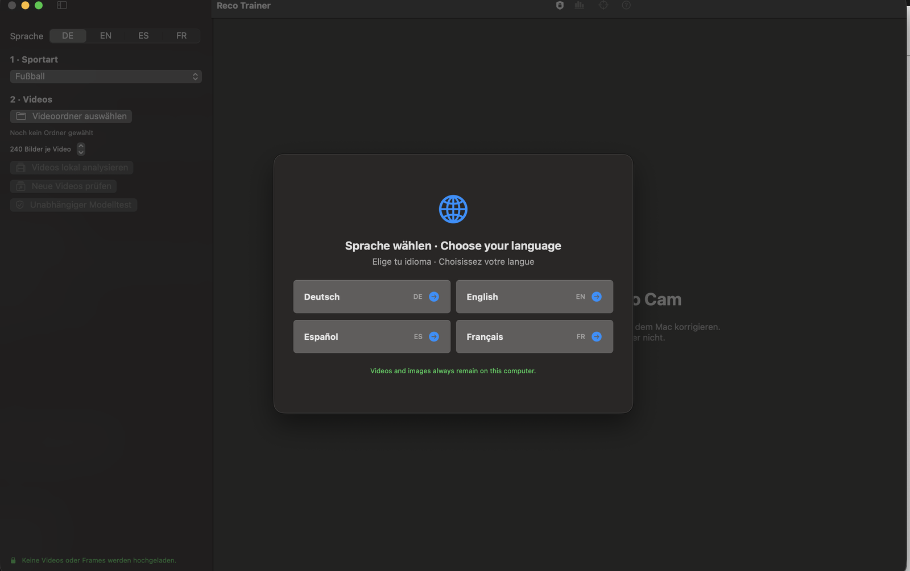
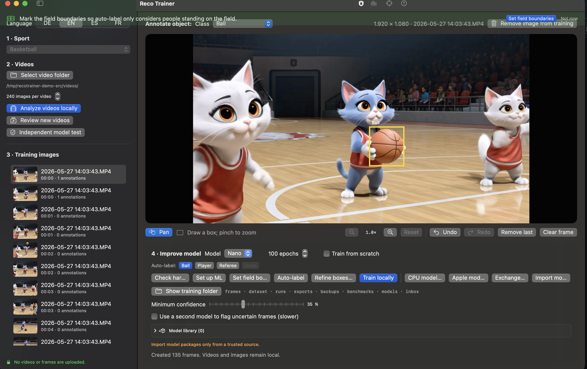
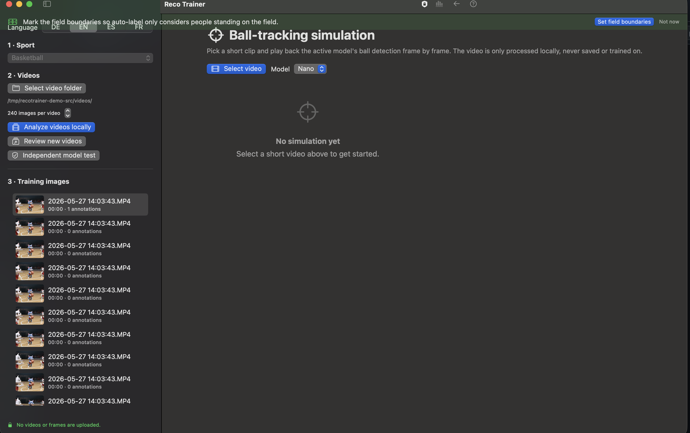

# Reco Trainer — User Guide

*A friendly introduction to training your own sports-object-detection model, no machine learning background required.*

All screenshots in this guide show AI-generated placeholder footage, not real recordings — see [Screenshots](#a-note-on-the-screenshots) at the end.

## Table of contents

1. [What is Reco Trainer, and why does "local" matter?](#1-what-is-reco-trainer-and-why-does-local-matter)
2. [Machine learning for the rest of us](#2-machine-learning-for-the-rest-of-us)
3. [Quickstart: your first model in five steps](#3-quickstart-your-first-model-in-five-steps)
4. [The core workflow, in detail](#4-the-core-workflow-in-detail)
5. [Advanced features](#5-advanced-features)
6. [Tips, troubleshooting, and good habits](#6-tips-troubleshooting-and-good-habits)
7. [Glossary](#7-glossary)

---

## 1. What is Reco Trainer, and why does "local" matter?

Reco Trainer is a tool for building a custom **object detection model** for your sport — something that can look at a video frame and draw a box around the ball, the players, the referee, the goal, or whatever else you care about. You feed it your own match or training footage, correct its mistakes a few times, and it gets better with each round.

The one thing Reco Trainer refuses to do, on principle, is send your footage anywhere. Every step — extracting frames, running the model, training, testing — happens on your own computer. Nothing is uploaded to a server, not even to "help improve the model for everyone." If you are training on footage of minors, of your own team, or of anything you'd rather not have leave the building, that matters more than a marginal accuracy gain from a shared cloud model ever could. It's also just simpler to reason about: what happens on your Mac (or your Windows/Linux machine, or your Docker container) stays on your Mac.

This guide walks through *why* the workflow is shaped the way it is, not just *which button to click* — understanding the "why" is what lets you get good results instead of just following steps blindly.

## 2. Machine learning for the rest of us

You don't need a machine learning background to use Reco Trainer, but a few core ideas will save you a lot of confusion later. Here they are, in plain English.

### A "model" is a pattern-matcher, not a rulebook

A detection model hasn't been *programmed* to recognize a basketball. It has looked at thousands of example images where someone drew a box around the basketball and said "this is a ball," and it gradually learned the visual pattern that tends to show up inside those boxes. It has no idea what a basketball actually *is* — it just knows what one tends to look like in pixels. That's why it can be fooled by things that look similar (an orange, a different kind of ball, a round shadow) and why it can miss the real ball if the lighting, angle, or blur is very different from anything it has seen before.

Reco Trainer doesn't start you from zero: it starts from **RF-DETR**, a strong general-purpose detection model that already understands "what an object roughly looks like." Training in Reco Trainer is really **fine-tuning** — nudging that existing knowledge toward *your* sport, *your* camera angle, and *your* categories, rather than teaching it to see from scratch. That's why useful results are possible from a few hundred frames instead of millions.

### Labeling is the whole game

Here's the part that surprises people coming from regular software: you don't really "program" the detection behavior. You *demonstrate* it, over and over, by telling the model "yes, that's a ball" or "no, that's not a player" on real example frames. The model then tries to generalize from those examples.

This means the model can only ever be as good as the labels you gave it. If you consistently draw boxes a bit too loosely, it learns to draw boxes a bit too loosely. If you miss the ball in blurry motion-heavy frames because they're annoying to label, the model will be bad at exactly those frames — which are often the ones you care about most. This isn't a Reco Trainer quirk; it's true of every model of this kind, from every vendor. In the field this is often summarized as **garbage in, garbage out**: a model trained on sloppy labels will confidently make sloppy predictions, and it will do so at real-time speed, which can look convincing right up until it matters.

The practical upshot: the time you spend correcting labels in the review screen is not busywork you're doing *for* the model — it is the training. Everything else in Reco Trainer (auto-labeling, active learning, training itself) exists to make that correction work faster and more targeted, not to replace it.

### Auto-labeling and "active learning" — getting the model to help you help it

Once you have *any* working model — even a rough first attempt — you can point it at new footage and have it guess the boxes for you. Reco Trainer calls this **auto-labeling**. You then don't have to draw every box from scratch; you just review the model's guesses and fix what's wrong. This is much faster than labeling blind, but it comes with a trap: if you only ever accept what the model already gets right, you never teach it anything new, and it plateaus.

**Active learning** is the fix for that trap. Instead of just running the model over everything, Reco Trainer can prioritize the frames the model is *least* sure about, or where two models disagree, or where a detection's position doesn't fit smoothly with its neighbors in time (see [Review-priority flags](#review-priority-flags-what-to-look-at-first) below). Those are exactly the frames most worth your attention — spending your limited review time there teaches the model more per minute than reviewing frames it already handles well.

### Training, epochs, and why "more" isn't always "better"

**Training** is the process of actually updating the model's internal parameters based on your labeled examples. It happens in rounds called **epochs** — one epoch means "the model has looked at every one of your labeled frames once and adjusted itself a little based on each one." Reco Trainer defaults to 100 epochs, which is a reasonable middle ground: enough rounds for the model to genuinely learn the pattern, not so many that training takes forever on a laptop.

More epochs isn't free, though. Train for too long on too little data and the model can start **overfitting** — memorizing your exact training frames (including their mistakes and quirks) instead of learning the general pattern. An overfit model looks great on the footage you trained it on and disappointing on anything new. This is one of the reasons Reco Trainer insists on testing against footage the model has genuinely never seen (see [Independent Model Test](#independent-model-test-a-fair-exam) below) rather than just trusting how well it does on its own training data.

### Confidence, precision, recall — reading the numbers without a statistics degree

A model doesn't just say "ball" or "not ball" — it outputs a **confidence** score for every guess, roughly "how sure am I." Reco Trainer's default cutoff is 0.35: guesses below that are treated as "not confident enough to show you." Raise the cutoff and you'll see fewer, more reliable boxes; lower it and you'll see more boxes, including more wrong ones.

When you compare models, you'll see a handful of standard metrics:

- **Precision** — of everything the model flagged as "ball," what fraction actually was a ball? Low precision means a lot of false alarms.
- **Recall** — of every real ball in the footage, what fraction did the model actually find? Low recall means it's missing things.
- **mAP** (mean Average Precision) — a single combined score that rewards a model for being both precise *and* thorough across all confidence levels. Higher is better; it's the number most people glance at first when comparing two models.

There's always a trade-off between precision and recall — a model that guesses "ball" on almost everything will have great recall and terrible precision, and vice versa. Which one matters more depends on what you're using the detections for.

## 3. Quickstart: your first model in five steps

If you just want to get moving, here's the short version. Each step is explained in much more depth in [section 4](#4-the-core-workflow-in-detail).

1. **Pick your sport and language.** Reco Trainer already knows the relevant categories (ball, player, referee, goal/hoop, …) for football, futsal, basketball, handball, hockey, rugby, lacrosse, and American football.
2. **Point it at a folder of your videos.** Reco Trainer extracts frames locally; nothing leaves your computer.
3. **Auto-label, then review.** Let the model guess, then walk through the candidates fixing what it got wrong. This is the step that actually teaches the model — don't rush it.
4. **Train.** Start a local training run (100 epochs by default) and let it work through your reviewed frames.
5. **Test and use.** Check the new model's numbers against an independent test set, then use it for auto-labeling more footage, live inference, or export it as a portable model package.

Then repeat steps 2–5 with new footage whenever you want the model to get better at something it's currently weak on.

## 4. The core workflow in detail

### Choosing a sport and language

Reco Trainer asks for your language and sport up front. The sport choice isn't cosmetic — it sets the category list you'll be labeling against (for example, basketball gives you *ball, player, referee, hoop*; football gives you *ball, player, goalkeeper, referee, goal*). Changing sport later is possible, but it makes sense to get this right at the start since it shapes everything downstream.

### First launch: video walkthrough or click-through guide

The very first time you open Reco Trainer, after picking a language, you can choose between a short video walkthrough (with captions in your chosen language) or the same tour as a click-through, text-based guide. Both cover the same ground — pick whichever you learn from better. You can reopen either one at any time from the "Show workflow" button in the toolbar.

### Selecting videos and extracting frames

Point Reco Trainer at a folder of video files. It extracts individual frames locally (by default, spread evenly through each video) that become the raw material for labeling. You don't need to extract *every* frame — the default of 60 well-spread frames per video is a good start (you can lower or raise it before extracting), since consecutive video frames tend to look almost identical anyway and don't each teach the model something new.

### Importing an existing dataset

Already have labelled images, for example a COCO or YOLO export? Select a working folder, then click **Import dataset** below the folder button and choose the dataset folder. This works even in a folder that has never been prepared: the project is started with the dataset. The images are copied into the project, the original folder is not changed, and the labels count as reviewed. Next to frames from real videos, imported images are used for training only; in a project of imported images alone they are split at random, so the quality numbers are not independent of the training data.

### Auto-labeling and reviewing candidates

Once you have at least a base model to work with, "Analyze videos locally" runs it over your extracted frames and proposes boxes. These proposals land in a review queue as **candidates** — nothing is added to your actual training set until you've looked at it.

Reviewing a candidate frame means one of:

- **Accepting** the model's boxes as-is, because they're correct.
- **Correcting** them — resizing, moving, deleting, or adding a box — when the model got close but not quite right.
- **Rejecting** the frame entirely when it's not useful (motion blur, empty scene, nothing of interest).

**Images without boxes.** An image with no boxes only goes into training after you click **Image is empty** in the editor. Use it for frames where there really is nothing to mark, such as an empty hall or a scene without ball, players or hoop. These background images teach the model what is *not* an object. Images you simply haven't labelled yet stay out of training. The summary shows how many there are ("without boxes, not in training"). Candidates where you chose "no ball", and images imported together with a label file, already count as checked.

Every correction you make is a small lesson for the *next* training run. This is genuinely the highest-leverage thing you can do to improve the model — more so than tweaking epochs or thresholds.

### Review-priority flags: what to look at first

Reco Trainer flags certain candidate frames as worth reviewing first, using two signals that need no manual setup:

- **Model disagreement** — if you have two installed models, an optional second pass compares their guesses; frames where they disagree are flagged, since disagreement usually means genuine ambiguity.
- **Temporal outliers** — for frames that are part of a video sequence, Reco Trainer checks whether a detection's position makes sense given where the same object was just before and just after. A ball that "teleports" between two frames is very likely a wrong detection, not a fast ball.

Flagged frames appear first in the queue with a warning icon and a short reason. This only ever changes review *order* — it never changes what gets trained on.

### Reviewing the results of a consistency check

**Check consistency** looks at already labelled images: a second detector, the timeline and optionally a local VLM. Every flagged image gets a ⚠️ in the image list. To work through them, click **Review N flagged images** above the list (or **Review one by one** in the result window); **Show flagged only** narrows the list. Below the image you then see the reason, the VLM's comment and a concrete suggestion:

- **red dashed** boxes: measurable duplicates, two boxes of the same class overlapping by at least 60 %; the less certain one would be removed,
- **green dashed** boxes: people or balls the second detector found that have no box yet.

For each image choose **Accept suggestion**, **Fix by hand** (correct the boxes in the image, then **Fixed, next**), **Reject, keep boxes** or **Delete image** (asks once more). Every decision takes the image off the list and moves to the next one; **Skip** leaves it flagged. If the VLM reports duplicates but no two boxes overlap strongly, the panel says it is probably a false alarm — players overlap all the time in team sports.

Checks run before 0.27 did not store the second detector's boxes. **Compute suggestions** runs only the second detector over the flagged images and stores what it would add, without changing any flag; on a few thousand images this takes a while and shares the GPU with any training that is running.

### More room for labeling and changing an existing class

The frame viewer takes almost the full window height, also on laptops (1366×768, 1440×900) and portrait monitors; training and model management sit below it, and the page scrolls to them. Use the collapse button above the training controls to fold them away; click again to restore them. This preference stays saved on the computer. Training settings and models are preserved while collapsed.

**Zoom and pan.** The mouse wheel (or a trackpad pinch) zooms to the point under the mouse, in every tool, up to 20×; the − and + buttons zoom around the centre in even steps (three clicks double the zoom). From about 3× the image shows its real pixels, which helps with a small ball. Box outlines, handles and labels keep the same thin size on screen at every zoom; zooming never changes a box's stored coordinates. **Reset view** returns to the whole frame.

**Keyboard shortcuts** (not while a text field, number field or list has the focus):

| Key | Action |
|---|---|
| Hold **Space** | Pan while held; on release the previous tool (for example **New box**) is active again |
| **B** | New box |
| **1**–**9** | Class 1–9 in the order of the class list (changes the selected box's class) |
| **←** / **→** | Previous / next frame |
| **Delete** / **Backspace** | Delete the selected box |
| **⌘/Ctrl+Z**, **⌘/Ctrl+Shift+Z** | Undo / redo |
| **Esc** | Deselect |

The class list shows each class with its key, e.g. "Ball (1)".

Click an existing box (or focus it and press Enter or Space). The class selector above the image now shows that box's class. Choose another class to save the correction, for example player to referee. The box keeps its position and size, becomes a manual label, and no longer shows the old model confidence. Undo and redo also apply to class changes. Use **New box** to return to drawing without changing the selected label. In **Pan** mode, dragging over a box still pans the view.

### Training, validation and test images

Reco Trainer splits your images by **whole videos**: neighbouring frames of one video look almost the same, so frames of one video in training and in validation would make the scores look better than they are. From three videos on, one video becomes validation and one becomes test; the rest train. With fewer videos the app falls back to a time split and says so.

Since 0.31.8 the chips above the image list show how many images train, validate and test (and which are not in training yet, for example unlabelled ones); click a chip to show only those images. Every image shows its role, and the **Train locally** dialog shows the split of the next run with a warning when there are no test images or very few validation images. For more variety in validation and test (other fields, sides, light), add more videos.

**Refreshing keeps your work.** Since 0.31.8 **Safely refresh frames** keeps the images and boxes of videos that are no longer in the working folder, so you can move videos to an external drive once their frames are extracted. Videos that were prepared before are not extracted again; only new videos are. To add videos from another folder and pre-label only those, use **Extend dataset**.

**Importing a Reco Trainer dataset keeps its roles.** An "Export dataset" folder or a copy of a project's own `dataset` folder was split by video already, so **Import labels** keeps its train/valid/test roles. Importing it again sets the roles of images imported before. Other datasets still import as training images, because their split is usually random.

### Training locally

**The ML environment is set up once per computer.** Since 0.26, **Set up ML** installs it into Reco Trainer's own folder (macOS: `~/Library/Application Support/Reco Trainer/ml-env`, Windows: `%LOCALAPPDATA%\Reco Trainer\ml-env`, Linux: `~/.local/share/reco-trainer/ml-env`), and every working folder uses it. A project that already has its own environment from an earlier version keeps using it, and Reco Trainer remembers it for new working folders, so you don't have to set up ML again. In Docker the environment stays in the project folder.

Once you've reviewed enough frames, start a training run. You'll set:

- **Epochs** — how many passes through your labeled data (100 by default; see [section 2](#training-epochs-and-why-more-isnt-always-better) for the trade-off).
- **Train from scratch** — normally training continues from the current checkpoint, which is faster and usually what you want. Turn this on when you've added a brand-new category the current model was never trained on (RF-DETR can't just bolt a new category onto an existing checkpoint's classification head — it needs a full run from the base model to actually learn it).

Training runs entirely on your machine, using your GPU if you have one and your CPU otherwise (slower, but it works). Progress and per-category metrics are shown as it goes.

**RF-DETR or YOLO.** RF-DETR (Apache-2.0) is the default. Since 0.30 the **Train locally** dialog also offers **YOLO26 Nano, Small and Medium** from Ultralytics; tick sizes of both families to compare them in one run (the report recommends the best one). YOLO is optional: the first time you choose it, tick the box that you accept the Ultralytics **AGPL-3.0** license, and Reco Trainer installs it into the ML environment (about 30 MB, pinned version). Models trained with it are AGPL-3.0 as well — keep that in mind before you share or sell them. For YOLO you also choose the **image size** (640, 960 or 1280 px): larger finds small balls better but needs more time and memory. A trained YOLO model lands in the model library like any other and is used for auto-labeling, **Test models** and the ball-tracking simulation; the next YOLO run of the same size continues from it. Core ML export, combined models and sharing as a `.recomodel` stay RF-DETR only. Reco Trainer switches off Ultralytics' usage statistics and automatic package installs.

**Which graphics cards are used.** On a Mac with Apple silicon, everything runs on the built-in GPU. On Windows and Linux, training uses an NVIDIA GPU through CUDA; without one it runs on the CPU. AMD and Intel graphics help with the other jobs (confirmed on an AMD Radeon RX 7800 XT with Windows 11: detection about 16 times faster than on the CPU):

- **Training on AMD (Windows).** With an AMD Radeon RX 7700 to 7900, RX 9060/9070, Radeon PRO W7700 to W7900 or AI PRO R9700, **Set up AMD training** appears next to **Set up ML** (after ML is set up). It installs AMD's ROCm build of PyTorch with RF-DETR into a separate folder, `%LOCALAPPDATA%\Reco Trainer\rocm-env` (about 4 GB download, 6 GB on disk), then checks the card with a small calculation and training step. Requirements: Python 3.12 from python.org (AMD ships PyTorch for Windows for 3.12 only; other Python versions stay installed) and a current Adrenalin driver (26.2.2 or newer). Afterwards **Train locally** with RF-DETR runs on the card. On an RX 7800 XT one test epoch took 16 s instead of 711 s on the CPU. The hardware line reads "Training on … (ROCm) · detection through DirectML". **Train on the AMD card** switches it off and on. Batch training does the same, YOLO included: the first batch with YOLO also installs YOLO into the AMD environment (a few hundred MB). If that fails, YOLO trains on the CPU and RF-DETR still on the card. Auto-labeling, benchmarks and export keep running in the normal ML environment. If training on the card stops, the error says so; switch the option off to train on the CPU. `tools\Test AMD Training.bat` remains as a stand-alone test that does not touch the app.
- **Asked first (Windows).** On a Windows PC without an NVIDIA GPU, Reco Trainer asks once whether to try the AMD or Intel graphics card; until you say yes, everything runs on the CPU. **Test graphics card (AMD/Intel)** next to **Set up ML** asks again. After a yes, a quick test runs. If the card fails then or in any later job, a diagnosis report opens (system, driver, DirectX, packages, a minimal DirectML test, the RF-DETR model on card and CPU, Vulkan) with **Copy report**, **Save as file**, **Test again** and **Use the CPU only** — please send that report when you report a problem.
- **Detection on Windows** (auto-labeling, the consistency check's second detector, benchmarks, the ball-tracking simulation) runs on any DirectX 12 graphics card through ONNX Runtime with DirectML. **Set up ML** installs it automatically when there is no NVIDIA GPU; the hardware line then reads "Training on the CPU · detection on the graphics card (DirectML)". The first detection with each model converts it once (a few seconds). If the graphics card fails, detection simply continues on the CPU. Set `RECO_ONNX_INFERENCE=off` to switch this off. The job log names the provider and the card (for example "Detection runs through ONNX Runtime (DmlExecutionProvider, AMD Radeon RX 7800 XT, 16 GB)"); "failed, continuing with PyTorch on the CPU" means the card could not run the model. An AMD or Intel card with 8 GB of its own memory puts the computer in the **medium** hardware tier (larger suggestion model, VLM available); integrated graphics stay **weak**.
- **The VLM of the consistency check** uses the Vulkan build of llama.cpp on every Windows or Linux x64 computer without an NVIDIA GPU. It runs on AMD and Intel graphics with a Vulkan driver, otherwise on the CPU, and if the graphics card cannot load the model it retries on the CPU by itself. `RECO_VLM_RUNTIME=cpu` forces the CPU build.

### What actually stays local

Every video frame, every label, every trained checkpoint, and every metric lives in your project folder on your own disk. Reco Trainer's own servers only ever see a version-check request (to tell you a new release exists) — never your footage, your labels, or your models.

## 5. Advanced features

### Independent Model Test — a fair exam

A model that's tested on the same footage it was trained on will always look better than it really is — it has effectively seen the answers already. **Independent Model Test** lets you designate a separate video folder — one that was *never* used for training — and turn it into a genuinely held-out test set. Model comparisons then use this independent set for their reference numbers, so a model can't score well purely because it recognizes footage it already knows.

If you only ever test on your training footage, you're not measuring how good your model is — you're measuring how well it memorized.

### Model Benchmark / Comparison

Once you have more than one model (say, an older and a newer version, or two models trained on different footage), the benchmark screen runs both against your independent test set and lays out precision, recall, mAP, and per-category breakdowns side by side. Look at the per-category numbers, not just the overall score — a model can look great overall while being genuinely bad at, say, detecting the referee, if referees are rare in your footage.

If the comparison cannot run yet, a box above the steps says what is missing (no images, unreviewed auto suggestions, no confirmed test set, no trained model for the sport, another job running) and what to do next; disabled buttons show the reason when you point at them.

A model with a different set of categories than your current one isn't automatically flagged as "worse" just because its overall score is lower — the scores aren't directly comparable in that case, and the comparison points you to the per-category view instead.

### Creating a combined model

If one model is your best performer for the ball and a different one is your best for the referee, you can "bake" a combined model: for each category, it uses whichever source model is strongest at it. This isn't a real merge of the underlying weights (RF-DETR doesn't support that) — each source model keeps handling its own assigned categories at inference time — but the result behaves like, and appears in your library as, an ordinary single model.

### Ball-tracking simulation

This panel plays back a short clip frame by frame, running the active model's ball detection live and color-coding the result: detected (green), interpolated between two real detections (orange), held at the last known position (yellow), or lost entirely. A slider controls how far ahead/behind the interpolation is allowed to look. It's a fast, visual way to sanity-check a model's real-world tracking behavior — including its failure modes — without setting up a full pipeline. Nothing here is saved or used for training; it's purely for your own inspection.

**Compare two models.** Click **Compare two models** to get two players side by side, A and B. Each side has its own model (the active model or any library model with a ball class, including imported ONNX YOLO models) and its own video; **Same video as A** runs the right-hand model on exactly the clip from the left. Both sides play on one shared timeline, so a shorter clip holds its last frame. Under each player you see how often the ball was tracked, detected, interpolated, held or lost, plus the average confidence. On the same video, a line below also counts the frames where both models, only A, or only B found the ball. Choosing a model here does not change the active model.

### Field geometry editor

Each video (each camera position) has its own outline, because a left and a right camera see the field in different places. The editor names the video it is editing (the one of the selected frame); **Use for all videos** stores the same outline for every video of the project. Projects from 0.28 or earlier copy their single outline to all their videos the first time they are opened (after a backup in `backups/`; the old value stays in `project.json` as `fieldGeometryBeforePerVideo`), so nothing changes for them. Auto-label filters each frame with the outline of its own video; a video without an outline is not filtered. Click the outline of the playing surface on a reference frame: at least four points, in order along the edge (up to 32); straight lines join them. For a fully visible rectangular field its four corners are enough. If the field leaves the frame, put points on the image edge where it does - any shape is possible. No measurements are needed. Drag a point to move it, or remove the last point if you misclicked; an outline whose edges cross cannot be saved. Auto-label then only adds players, referees and goalkeepers whose feet are on the field, so spectators, the bench and staff next to the court are ignored. Reco Trainer suggests this when the selected frame's video has no outline yet; you can skip it, and you can change it at any time with **Edit field boundaries**. To delete it, open **Edit field boundaries** and click **Remove field boundary** twice (the first click asks for confirmation): it removes the outline of this video, or of every video with **Use for all videos** ticked, after a backup in `backups/`; auto-label then no longer filters those videos. It is available in the Mac app and in the Windows, Linux and Docker interface.

### Augmentation Studio

The **✦ Augmentation Studio** button in the header turns labelled full-court images into extra training images: it moves players, referees and the ball to new places in the same venue, with matching size and perspective, and writes the labels again. Validation and test always stay real images, so you can compare a model trained on **Real + synthetic** with one trained on **Real only, same split** under **Test models**. Start with at least 300 (ideally 500) reviewed images from several recordings and 1,500–2,000 variations.

A step-by-step guide opens every time you open the studio. Tick **Don't show again** to hide it; the **Guide** button in the studio brings it back.

### Model packages (`.recomodel`)

A trained model can be exported as a single `.recomodel` package — useful for moving a model between machines, sharing it with a teammate, or backing it up. On import (and again immediately before any actual use, such as training, auto-labeling, or export), Reco Trainer checks the package against its manifest checksum and additionally loads it through PyTorch's safe-loading mode, which rejects anything containing more than plain model weights — such as executable code that would otherwise run automatically when the file is opened. This matters because a checksum alone only proves a file matches its own manifest, not that it's safe: whoever builds a package also controls its checksum. Treat model packages the same way you'd treat any other file from someone else — only import ones you trust.

## 6. Tips, troubleshooting, and good habits

- **Review before you train, every time.** A training run only ever learns from frames you've actually reviewed — candidates still sitting in the queue are ignored.
- **Prefer variety over volume.** Fifty frames spanning different lighting, angles, and situations teach the model more than five hundred near-identical frames from one clip.
- **Don't skip the hard frames.** The blurry, awkward, oddly-lit frames you're tempted to reject are usually exactly the ones the model needs to see to get good at real match conditions.
- **Use an independent test set honestly.** Resist the temptation to peek at test footage while labeling training data — the moment you do, it stops being independent.
- **Retrain instead of tweaking thresholds forever.** If a model consistently misses something, lowering the confidence threshold treats the symptom; showing it more corrected examples of that exact situation treats the cause.

## 7. Glossary

| Term | Plain-English meaning |
|---|---|
| **Model** | The trained pattern-matcher that looks at an image and proposes boxes + categories. |
| **RF-DETR** | The general-purpose detection model Reco Trainer starts from before fine-tuning it on your footage. |
| **Fine-tuning** | Continuing to train an existing model on new, specific data instead of starting from nothing. |
| **Label / annotation** | A box drawn around an object in a frame, tagged with its category (ball, player, …). |
| **Auto-labeling** | Having the current model guess labels for new frames automatically, for you to review. |
| **Active learning** | Prioritizing which unlabeled frames to review next based on where the model is least certain. |
| **Candidate** | A frame with model-proposed labels that hasn't been reviewed yet. |
| **Epoch** | One full pass of the training process through all your labeled frames. |
| **Overfitting** | A model that has memorized its training data's quirks instead of learning the general pattern — looks great on training footage, disappoints on new footage. |
| **Confidence threshold** | The minimum certainty score a detection needs before Reco Trainer shows it to you. |
| **Precision** | Of everything flagged as an object, the fraction that was actually correct. |
| **Recall** | Of every real object present, the fraction the model actually found. |
| **mAP** | A single combined accuracy score balancing precision and recall — higher is better. |
| **Independent test set** | Footage the model has never seen used purely for evaluation, never for training. |
| **Checkpoint** | A saved snapshot of a model's trained state that training can continue from. |
| **`.recomodel`** | Reco Trainer's portable, checksummed model-package file format. |

---

## A note on the screenshots

Every screenshot in this guide was captured from Reco Trainer running against AI-generated placeholder footage — never real match recordings of real people. That's a deliberate choice, not an oversight: this guide exists to help you use a tool that's built around keeping *your* footage private, so it would be a strange way to start by publishing someone else's.
